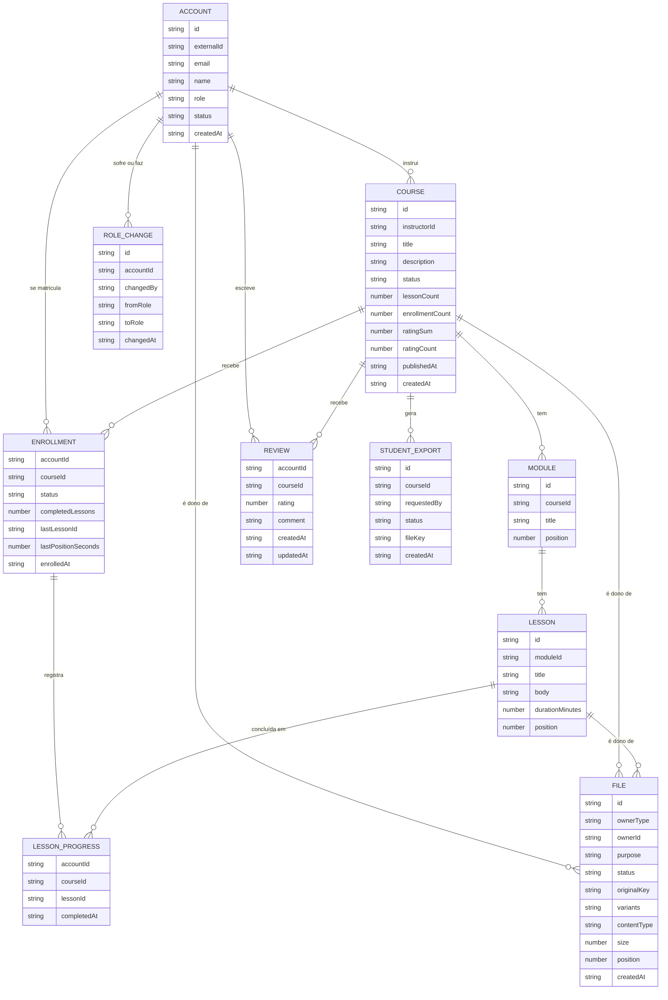

# Modelo de dados

Documento da história PLAN-3. Segue o processo de `dynamodb-single-table-design`: ERD → lista de padrões de acesso → quadro de entidades (PK/SK) → índices secundários → desnormalização e contadores → validação.

As decisões que justificam cada parte estão em `PLANNING.md` (número da pergunta entre parênteses).

## 1. ERD

Tipos genéricos e sem chaves: as chaves saem do passo 3. O item de unicidade `EMAIL#` e os itens de idempotência da fila são físicos e não aparecem aqui.

### Valores fechados

| Atributo | Valores | Decisão |
|---|---|---|
| `Account.role` | `student`, `instructor`, `admin` | Q20, Q43 |
| `Account.status` | `PENDING`, `ACTIVE`, `DISABLED` (`DELETED` como evolução) | Q39, Q56 |
| `Course.status` | `DRAFT`, `PUBLISHED`, `ARCHIVED` | Q10 |
| `Enrollment.status` | `ACTIVE`, `CANCELLED` | Q49 |
| `File.ownerType` | `account`, `course`, `lesson` | Q53 |
| `File.purpose` | `avatar` (conta), `cover` (curso), `attachment` e `video` (aula) | Q53, Q54 |
| `File.status` | `PENDING`, `UPLOADED`, `PROCESSED`, `FAILED` | Q53 |

### Regras que o modelo precisa respeitar

- Uma avaliação por par aluno + curso, que sobrevive ao cancelamento (Q47).
- Rematrícula reativa a mesma matrícula e mantém o progresso (Q49).
- Curso publicado ganha aulas, não perde; curso em rascunho pode ser apagado com módulos e aulas, sem progresso a perder (Q24, Q51).
- Avatar e capa: um atual por dono; trocar apaga os arquivos antigos (Q50, Q53).
- Só matrícula `ACTIVE` acessa material e vídeo (Q58).
- Sem versionamento de curso (Q59).

## 2. Padrões de acesso

Revisão da Q22 com o escopo atual (Q65 a Q68). As colunas de índice, chaves e operação são preenchidas nos passos 3 e 4.

| # | Padrão | Filtro / ordem | Quem | Frequência |
|---|---|---|---|---|
| 1 | Buscar conta por id (`internalId`) | — | sistema (trigger de token, toda rota privada) | alta |
| 1b | Verificar e-mail livre / buscar conta por e-mail | e-mail exato | sistema (sign-up), admin | baixa |
| 2 | Listar usuários | por papel e status, mais recentes primeiro, paginado | admin | baixa |
| 3 | Criar, editar, publicar, arquivar, apagar curso em rascunho | — | instrutor | baixa |
| 4 | Cursos de um instrutor | todos os estados, mais recentes primeiro | instrutor | média |
| 5 | Catálogo | publicados, mais recentes primeiro, paginado | público | alta |
| 6 | Curso completo | curso + módulos + aulas em ordem de posição + capa | público | alta |
| 7 | Criar, editar, reordenar, apagar módulos e aulas | — | instrutor | média |
| 8 | Matricular, cancelar, rematricular | — | aluno | média |
| 8b | Buscar a matrícula de um aluno num curso | aluno + curso | sistema (todo acesso a aula, material e vídeo) | **crítica** |
| 9 | Minhas matrículas | só ativas, com título e progresso, mais recentes primeiro | aluno | alta |
| 10 | Alunos de um curso | só ativos, paginado; o CSV lê todos | instrutor | baixa |
| 11 | Marcar aula como concluída, uma vez só | — | aluno | alta |
| 12 | Meu progresso num curso | aulas concluídas + última aula e posição | aluno | alta |
| 13 | Avaliar e editar a avaliação | uma por aluno + curso | aluno | baixa |
| 14 | Avaliações de um curso | mais recentes primeiro, paginado | público | média |
| 15 | Buscar cursos por texto, e outras ordens do catálogo | Algolia | público | média |
| 16 | Salvar a posição no vídeo | a cada 15 a 30 s | aluno | **crítica** |
| 17 | Histórico de papéis de uma conta | mais recentes primeiro | admin | baixa |
| 18 | Arquivo atual de um dono por finalidade | avatar da conta, capa do curso, vídeo da aula | sistema, público | alta |
| 19 | Materiais de uma aula | em ordem de posição | aluno ativo | média |
| 20 | Arquivo por id | atualizar o status pelo trigger do S3 | sistema | média |
| 21 | Exportações de um curso; exportação por id | mais recentes primeiro | instrutor | baixa |
| — | Conta `PENDING` vencida, upload `PENDING` abandonado | TTL, sem query | sistema | — |

Fora do DynamoDB, de propósito: outras ordens e filtros do catálogo vão para o Algolia (Q66); busca de usuários por nome espera o painel de admin (Q67).

Pontos críticos para o passo 3 (Q68): o padrão 16 grava num item à parte, pequeno, para não reescrever a matrícula; o padrão 8b é um `GetItem` pela chave aluno + curso, sem índice.
