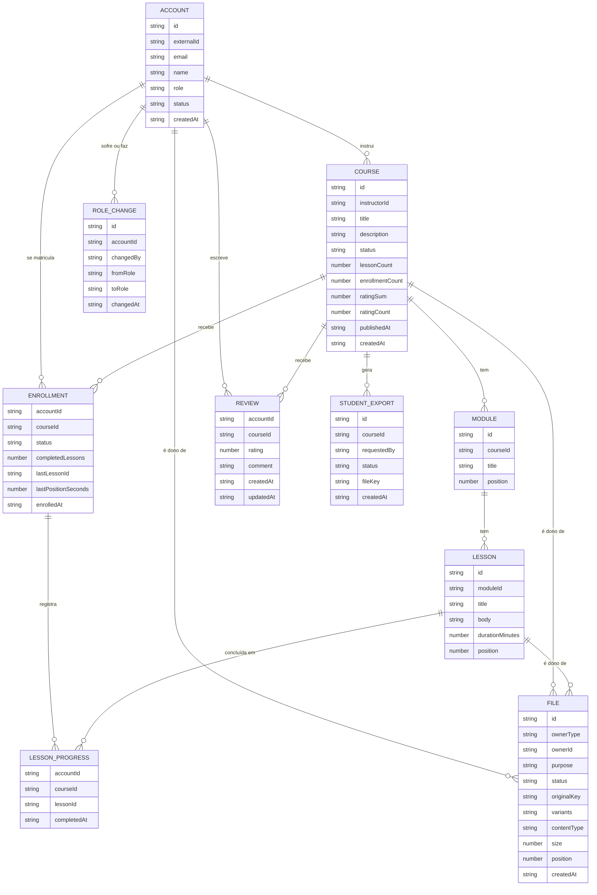

# Modelo de dados

Documento da história PLAN-3. Segue o processo de `dynamodb-single-table-design`: ERD → lista de padrões de acesso → quadro de entidades (PK/SK) → índices secundários → desnormalização e contadores → validação.

As decisões que justificam cada parte estão em `PLANNING.md` (número da pergunta entre parênteses).

## 1. ERD

Tipos genéricos e sem chaves: as chaves saem do passo 3. O item de unicidade `EMAIL#` e os itens de idempotência da fila são físicos e não aparecem aqui.



### Valores fechados

| Atributo | Valores | Decisão |
|---|---|---|
| `Account.role` | `student`, `instructor`, `admin` | Q20, Q43 |
| `Account.status` | `PENDING`, `ACTIVE`, `DISABLED` (`DELETED` como evolução) | Q39, Q56 |
| `Course.status` | `DRAFT`, `PUBLISHED`, `ARCHIVED` | Q10 |
| `Enrollment.status` | `ACTIVE`, `CANCELLED` | Q49 |
| `File.ownerType` | `account`, `course`, `lesson` | Q53 |
| `File.purpose` | `avatar` (conta), `cover` (curso), `attachment` e `video` (aula) | Q53, Q54 |
| `File.status` | `PENDING`, `UPLOADED`, `PROCESSED`, `FAILED` | Q53 |

### Regras que o modelo precisa respeitar

- Uma avaliação por par aluno + curso, que sobrevive ao cancelamento (Q47).
- Rematrícula reativa a mesma matrícula e mantém o progresso (Q49).
- Curso publicado ganha aulas, não perde; curso em rascunho pode ser apagado com módulos e aulas, sem progresso a perder (Q24, Q51).
- Avatar e capa: um atual por dono; trocar apaga os arquivos antigos (Q50, Q53).
- Só matrícula `ACTIVE` acessa material e vídeo (Q58).
- Sem versionamento de curso (Q59).

## 2. Padrões de acesso

Revisão da Q22 com o escopo atual (Q65 a Q68). As colunas de índice, chaves e operação são preenchidas nos passos 3 e 4.

| # | Padrão | Filtro / ordem | Quem | Frequência |
|---|---|---|---|---|
| 1 | Buscar conta por id (`internalId`) | — | sistema (trigger de token, toda rota privada) | alta |
| 1b | Verificar e-mail livre / buscar conta por e-mail | e-mail exato | sistema (sign-up), admin | baixa |
| 2 | Listar usuários | por papel e status, mais recentes primeiro, paginado | admin | baixa |
| 3 | Criar, editar, publicar, arquivar, apagar curso em rascunho | — | instrutor | baixa |
| 4 | Cursos de um instrutor | todos os estados, mais recentes primeiro | instrutor | média |
| 5 | Catálogo | publicados, mais recentes primeiro, paginado | público | alta |
| 6 | Curso completo | curso + módulos + aulas em ordem de posição + capa | público | alta |
| 7 | Criar, editar, reordenar, apagar módulos e aulas | — | instrutor | média |
| 8 | Matricular, cancelar, rematricular | — | aluno | média |
| 8b | Buscar a matrícula de um aluno num curso | aluno + curso | sistema (todo acesso a aula, material e vídeo) | **crítica** |
| 9 | Minhas matrículas | só ativas, com título e progresso, mais recentes primeiro | aluno | alta |
| 10 | Alunos de um curso | só ativos, paginado; o CSV lê todos | instrutor | baixa |
| 11 | Marcar aula como concluída, uma vez só | — | aluno | alta |
| 12 | Meu progresso num curso | aulas concluídas + última aula e posição | aluno | alta |
| 13 | Avaliar e editar a avaliação | uma por aluno + curso | aluno | baixa |
| 14 | Avaliações de um curso | mais recentes primeiro, paginado | público | média |
| 15 | Buscar cursos por texto, e outras ordens do catálogo | Algolia | público | média |
| 16 | Salvar a posição no vídeo | a cada 15 a 30 s | aluno | **crítica** |
| 17 | Histórico de papéis de uma conta | mais recentes primeiro | admin | baixa |
| 18 | Arquivo atual de um dono por finalidade | avatar da conta, capa do curso, vídeo da aula | sistema, público | alta |
| 19 | Materiais de uma aula | em ordem de posição | aluno ativo | média |
| 20 | Arquivo por id | atualizar o status pelo trigger do S3 | sistema | média |
| 21 | Exportações de um curso; exportação por id | mais recentes primeiro | instrutor | baixa |
| 22 | Abrir uma aula | conteúdo, vídeo e materiais; só matrícula ativa | aluno | alta |
| — | Conta `PENDING` vencida, upload `PENDING` abandonado | TTL, sem query | sistema | — |

Fora do DynamoDB, de propósito: outras ordens e filtros do catálogo vão para o Algolia (Q66); busca de usuários por nome espera o painel de admin (Q67).

Pontos críticos para o passo 3 (Q68): o padrão 16 grava num item à parte, pequeno, para não reescrever a matrícula; o padrão 8b é um `GetItem` pela chave aluno + curso, sem índice.

## 3. Quadro de entidades

Tabela `MainTable` com `PK` e `SK`, e dois índices globais sobrecarregados, `GSI1` (`GSI1PK`, `GSI1SK`) e `GSI2` (`GSI2PK`, `GSI2SK`). Todo item leva `type` e `id`. Ids são KSUID, que ordenam por tempo (`dynamodb-key-design`), com resolução de um segundo: ids do mesmo segundo ficam na ordem da parte aleatória, então "mais recentes primeiro" vale entre segundos, não dentro de um. Decisões: Q71 a Q78.

| Entidade | PK | SK | GSI1PK / GSI1SK | GSI2PK / GSI2SK |
|---|---|---|---|---|
| Account | `ACCOUNT#<accountId>` | `ACCOUNT#<accountId>` | `ROLE#<role>` / `ACCOUNT#<accountId>` | `EMAIL#<email>` / `ACCOUNT#<accountId>` |
| RoleChange | `ACCOUNT#<accountId>` | `ROLE_CHANGE#<changeId>` (KSUID) | | |
| Course | `COURSE#<courseId>` | `COURSE#<courseId>` | `INSTRUCTOR#<instructorId>` / `COURSE#<courseId>` | só publicados: `CATALOG` / `<publishedAt>#<courseId>` |
| Module | `COURSE#<courseId>` | `MODULE#<moduleId>` | | |
| Lesson (sumário) | `COURSE#<courseId>` | `MODULE#<moduleId>#LESSON#<lessonId>` | | |
| LessonContent | `LESSON#<lessonId>` | `CONTENT` | | |
| Enrollment | `ACCOUNT#<accountId>` | `ENROLLMENT#<courseId>` | só ativas: `COURSE#<courseId>` / `ENROLLMENT#<enrolledAt>#<accountId>` | |
| Progress (posição) | `ACCOUNT#<accountId>` | `PROGRESS#<courseId>` | | |
| LessonProgress | `ACCOUNT#<accountId>` | `PROGRESS#<courseId>#LESSON#<lessonId>` | | |
| Review | `ACCOUNT#<accountId>` | `REVIEW#<courseId>` | `COURSE#<courseId>` / `REVIEW#<createdAt>#<accountId>` | |
| File | `<OWNER>#<ownerId>` | `FILE#<purpose>#<fileId>` | | |
| StudentExport | `EXPORT#<exportId>` | `EXPORT#<exportId>` | `COURSE#<courseId>` / `EXPORT#<exportId>` | |

### Itens físicos que não são entidades

- **Reserva de e-mail** (Q78): `PK = SK = EMAIL_CLAIM#<email normalizado>`, com `accountId`. Gravada e movida só pelo `AccountRepository`, na mesma transação da Account, com `attribute_not_exists(PK)`. Não entra em índice. Sai junto com a Account, numa transação em que a remoção da reserva exige `accountId` igual ao da conta: uma compensação nunca libera um e-mail que outra conta segura (1.4.e). Na confirmação, conta e reserva perdem o `expiresAt` na mesma transação, e a conta vira `ACTIVE` só se ainda estiver `PENDING` (Q139).

### Regras de escrita

- Toda escrita que toca mais de um item é uma transação (Q71).
- A troca de papel atualiza `role` e `GSI1PK` da Account, só com a conta `ACTIVE` e ainda no papel de origem, e grava o `RoleChange` na mesma transação (Q173); o primeiro admin tem `changedBy = bootstrap`.
- A posição de módulos e aulas é atributo; o padrão 6 ordena no código. Mover aula de módulo é delete + put em transação.
- Criações usam `attribute_not_exists(PK)` (aula concluída uma vez, uma avaliação por par, unicidade do e-mail).
- O e-mail é normalizado (trim, minúsculas) antes de entrar em qualquer chave.
- O `externalId` (o `sub` do Cognito) nasce vazio e é gravado na Account depois do `SignUp` (1.4.f); o atributo só existe no item quando preenchido.

### Como cada padrão é servido

| # | Padrão | Índice | Chave | Operação |
|---|---|---|---|---|
| 1 | Conta por id | tabela | `ACCOUNT#a` / `ACCOUNT#a` | Get; forte no trigger de pre token, a cada sign-in e refresh (Q88, Q145); eventual em `GET`/`PATCH /me` (Q166); `PATCH` com Update `ALL_NEW` (Q167) |
| 1b | Conta por e-mail | `GSI2` | `EMAIL#e` | Query (o índice nasce com o primeiro uso, Q144) |
| 1c | Conta por e-mail pela reserva (confirmação, reenvio, recuperação de senha; o use case confere o status) | tabela | `EMAIL_CLAIM#e`, depois `ACCOUNT#a` | Dois Get fortes; item vencido conta como ausente (Q137, Q142) |
| 2 | Usuários por papel | `GSI1` | `ROLE#r` | Query, de trás para frente; status por filtro |
| 4 | Cursos do instrutor | `GSI1` | `INSTRUCTOR#i` | Query, de trás para frente |
| 5 | Catálogo | `GSI2` | `CATALOG` | Query, de trás para frente |
| 6 | Curso completo | tabela | `COURSE#c` | Query (curso, módulos, aulas, capa) |
| 8b | Matrícula aluno + curso | tabela | `ACCOUNT#a` / `ENROLLMENT#c` | Get |
| 9 | Minhas matrículas | tabela | `ACCOUNT#a`, `begins_with ENROLLMENT#` | Query com filtro de ativas |
| 10 | Alunos do curso | `GSI1` | `COURSE#c`, `begins_with ENROLLMENT#` | Query |
| 11 | Concluir aula | tabela | `ACCOUNT#a` / `PROGRESS#c#LESSON#l` | Put condicional + update do contador, em transação |
| 12 | Meu progresso | tabela | `ACCOUNT#a`, `begins_with PROGRESS#c` | Query |
| 13 | Minha avaliação | tabela | `ACCOUNT#a` / `REVIEW#c` | Get / Put condicional |
| 14 | Avaliações do curso | `GSI1` | `COURSE#c`, `begins_with REVIEW#` | Query, de trás para frente |
| 16 | Salvar posição | tabela | `ACCOUNT#a` / `PROGRESS#c` | Update |
| 17 | Histórico de papéis | tabela | `ACCOUNT#a`, `begins_with ROLE_CHANGE#` | Query, de trás para frente |
| 18 | Arquivo atual do dono | tabela | `<OWNER>#o`, `begins_with FILE#<purpose>#` | Query |
| 19, 22 | Abrir aula, materiais | tabela | `LESSON#l` | Query (conteúdo, vídeo, materiais) |
| 20 | Arquivo por id | tabela | derivada da chave do S3 | Get |
| 21 | Exportações | `GSI1` / tabela | `COURSE#c`, `begins_with EXPORT#` / `EXPORT#e` | Query / Get |

## 4. Índices secundários

| Índice | Chaves | Projeção | Quem usa |
|---|---|---|---|
| `GSI1` | `GSI1PK`, `GSI1SK` | `ALL` | Account por papel (2), cursos do instrutor (4), alunos ativos (10, esparso), avaliações (14), exportações (21) |
| `GSI2` | `GSI2PK`, `GSI2SK` | `ALL` | Conta por e-mail (1b), catálogo (5, esparso: só cursos publicados) |

Os dois são genéricos: a entidade escreve os atributos de índice que precisa e o prefixo separa os padrões (Q79). Uma matrícula cancelada perde `GSI1PK`/`GSI1SK`; um curso que deixa de estar publicado perde `GSI2PK`/`GSI2SK`.

## 5. Cópias e contadores

Cada valor duplicado tem um tipo e um dono (`dynamodb-denormalization`; Q80 a Q84).

| Atributo | Em | Tipo | Dono |
|---|---|---|---|
| `studentName` | Enrollment, Review | exibição | A rota que renomeia a conta: query em `ACCOUNT#a`, transações de até 100 itens |
| `instructorName` | Course | exibição | A rota que renomeia a conta: cursos do instrutor pelo `GSI1` |
| `cover` (`fileId`, `variants`) | Course | exibição | O processador de imagem, na transação que marca o `FILE` como `PROCESSED` (Q85) |
| `avatar` (`fileId`, `variants`) | Account | exibição | O mesmo, para o avatar (Q85) |
| `enrollmentCount` | Course | contador | Matricular, cancelar, rematricular (`ADD` na transação) |
| `lessonCount` | Course | contador | Acrescentar e apagar aula (`ADD` na transação) |
| `ratingSum`, `ratingCount` | Course | contador | Criar avaliação; editar soma a diferença (`ADD` na transação) |
| `completedLessons` | Enrollment | contador | Concluir aula (`ADD` na transação, com o put condicional do progresso) |
| `rating`, `comment` | Review | retrato | Escritos pelo aluno; não seguem nada |
| `fromRole`, `toRole` | RoleChange | retrato | Escritos uma vez |
| `enrolledAt` | Enrollment | retrato | Escrito na primeira matrícula; a rematrícula não muda |
| `fileKey` | StudentExport | retrato | O job de exportação |
| título, capa, total de aulas do curso | (não copiados) | referência | "Minhas matrículas" lê os cursos por `BatchGet` |
| entradas de `GSI1` e `GSI2` | índices | índice | O DynamoDB, a cada escrita |

Percentual de progresso e média de avaliação são calculados na leitura, nunca gravados. Contadores nunca dependem do stream; o stream só alimenta cópias externas (Algolia, limpeza do Cognito).

### Formato da cópia de imagem (Q85)

```json
"avatar": {
  "fileId": "2Pz91m",
  "variants": {
    "64": "account/2NxK8q/avatar/2Pz91m/64-a1b2c3.webp",
    "256": "account/2NxK8q/avatar/2Pz91m/256-d4e5f6.webp"
  }
}
```

Guarda chaves do S3, não URLs: o controller monta a URL com o domínio da CDN. Trocar a imagem é uma transação que marca o `FILE` novo como `PROCESSED`, aponta a cópia para ele e apaga o `FILE` antigo, com a condição "o `fileId` atual ainda é o antigo".

## 6. Validação

Lista percorrida contra o quadro de entidades em 2026-10-14:

- Os 22 padrões de leitura saem por Get ou Query; nenhum Scan. Filtros só no status da lista de usuários (Q76) e nas matrículas ativas (Q74).
- Regras de negócio em transações com condição: matricular exige curso `PUBLISHED` (condição no update do contador do curso); concluir aula e avaliar exigem matrícula `ACTIVE` (`ConditionCheck`).
- Operações com mais de 100 itens (apagar curso em rascunho) são feitas em duas etapas: transação que marca `DELETING` e job idempotente em lotes (Q86).
- Para a PLAN-4: a limpeza do Cognito (Q41) lê o `externalId` da conta apagada pelo TTL, então o stream precisa de `NEW_AND_OLD_IMAGES`.
