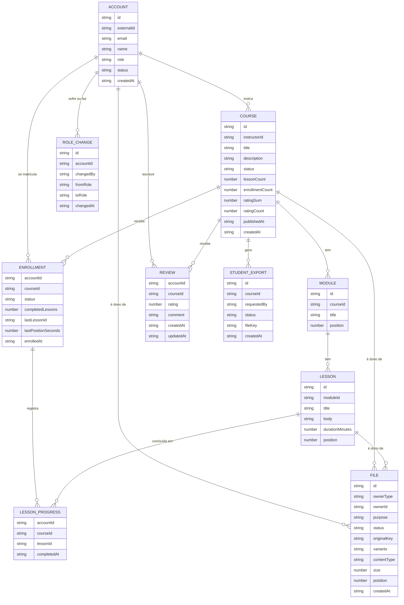

# Modelo de dados

Documento da história PLAN-3. Segue o processo de `dynamodb-single-table-design`: ERD → lista de padrões de acesso → quadro de entidades (PK/SK) → índices secundários → desnormalização e contadores → validação.

As decisões que justificam cada parte estão em `PLANNING.md` (número da pergunta entre parênteses).

## 1. ERD

Tipos genéricos e sem chaves: as chaves saem do passo 3. O item de unicidade `EMAIL#` e os itens de idempotência da fila são físicos e não aparecem aqui.

### Valores fechados

| Atributo | Valores | Decisão |
|---|---|---|
| `Account.role` | `student`, `instructor`, `admin` | Q20, Q43 |
| `Account.status` | `PENDING`, `ACTIVE`, `DISABLED` (`DELETED` como evolução) | Q39, Q56 |
| `Course.status` | `DRAFT`, `PUBLISHED`, `ARCHIVED` | Q10 |
| `Enrollment.status` | `ACTIVE`, `CANCELLED` | Q49 |
| `File.ownerType` | `account`, `course`, `lesson` | Q53 |
| `File.purpose` | `avatar` (conta), `cover` (curso), `attachment` e `video` (aula) | Q53, Q54 |
| `File.status` | `PENDING`, `UPLOADED`, `PROCESSED`, `FAILED` | Q53 |

### Regras que o modelo precisa respeitar

- Uma avaliação por par aluno + curso, que sobrevive ao cancelamento (Q47).
- Rematrícula reativa a mesma matrícula e mantém o progresso (Q49).
- Curso publicado ganha aulas, não perde; curso em rascunho pode ser apagado com módulos e aulas, sem progresso a perder (Q24, Q51).
- Avatar e capa: um atual por dono; trocar apaga os arquivos antigos (Q50, Q53).
- Só matrícula `ACTIVE` acessa material e vídeo (Q58).
- Sem versionamento de curso (Q59).
